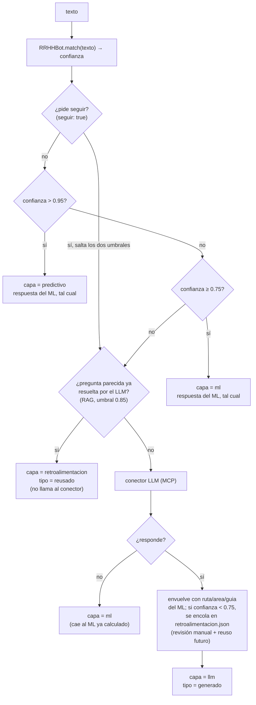
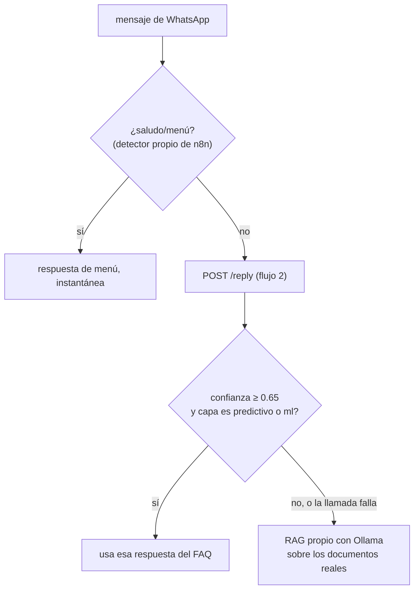

# Flujos: cómo responde cada canal, hoy

Mapa de referencia de **todos** los caminos que puede tomar la pregunta de un
colaborador, con el contrato de cada pieza. Es el **nivel 1** de la
documentación: describe lo que el código hace hoy y cita las reglas de
[`CONSTITUTION.md`](CONSTITUTION.md) sin crear otras. Lo que todavía no cumple
una regla está en la sección 4.

## 1. Los cinco flujos

| # | Flujo | Entra por | Quién decide la respuesta |
|---|---|---|---|
| 1 | Portal, búsqueda predictiva | Escribir en el buscador | Solo `rank()` de `dist/app.js` -- JS puro, sin red |
| 2 | Portal, "Preguntar al asistente" | Enter sin sugerencia, o clic en el botón | `model/orquestador.py` (vía `POST /reply`) |
| 3 | WhatsApp local (`whatsapp_service.py`) | Webhook del emulador/Meta | `RRHHBot.match()` **directo** -- no pasa por el orquestador, ver nota en §4 |
| 4 | WhatsApp real/emulador por n8n (puertas 01/02) | Webhook de n8n | La cadena **propia de n8n** (su Cerebro), independiente de la de Python |
| 5 | Burbuja de chat del portal (puerta Web de n8n) | Chat Trigger de n8n | Misma cadena que el flujo 4 |

`model/entrenar.py` no es un flujo de respuesta -- calibra umbrales y
embeddings, no contesta preguntas de un colaborador.

## 2. La cadena de Python (flujo 2): predictivo → ML → LLM

Dueña del código: `model/orquestador.py`. Se activa en cada `POST /reply`
que recibe texto no vacío.



Los umbrales (0.95, 0.75, y 0.85 para el reuso) y el orden de las capas son
datos editables en `model/arquitectura.json` (cargados por
`model/configuracion.py`), no constantes de código. Reglas que aplican: R8 y
R9. El paso de reuso
(`model/rag_retroalimentacion.py`) no es una capa nueva en la cadena
ratificada (Predictivo/ML/Agentic) -- es una optimización dentro del paso
de escalada, para no pagarle al LLM dos veces por preguntas parecidas.

### Contrato de `POST /reply`

```jsonc
// entrada
{ "text": "¿Cuántos días de vacaciones tengo?", "seguir": false }

// salida
{
  "reply": "...",
  "ruta": "vacaciones" | null,
  "area": "Gestión Humana" | null,
  "confianza": 0.92 | null,
  "sentimiento": { "etiqueta": "positivo", "estrellas": 5, "confianza": 0.8 } | null,
  "guia": "..." | null,
  "tipo": "confiado" | "acotar" | "saludo" | "grosero" | "fallback" | "generado" | "reusado" | null,
  "capa": "predictivo" | "ml" | "llm" | "retroalimentacion" | null
}
```

- `seguir` es opcional (default `false`): fuerza la escalada al conector
  LLM sin importar el umbral -- pensado para un futuro botón "esto no es
  lo que buscaba" en la UI; **hoy ningún cliente lo manda todavía**
  (`dist/app.js` no lo incluye, el nodo HTTP del Cerebro de n8n tampoco).
- `tipo`/`capa` son aditivos: `dist/app.js` y el Tier 1 de n8n siguen
  leyendo solo los campos que ya conocían (`reply`, `ruta`, `area`,
  `confianza`, `sentimiento`) sin romperse.
- Con texto vacío, todos los campos nuevos (`guia`, `tipo`, `capa`) vienen
  `null`, igual que los que ya existían.

### Qué significa `capa`

Fuente común para quien consuma la API (R10):

| `capa` | Origen del texto |
|---|---|
| `predictivo`, `ml` | Respuesta ya escrita del FAQ o mensaje fijo del bot |
| `llm`, `retroalimentacion` | Texto generado por un modelo de lenguaje |
| ausente, `null` u otro valor | Sin origen identificado |

### El conector LLM (capa "llm")

`model/conectores.py` -- intercambiable, vía la variable de entorno
`LLM_CONECTOR`:

| `LLM_CONECTOR` | Conector | Variables relacionadas |
|---|---|---|
| sin definir, o cualquier otro valor | `ConectorNulo` -- nunca responde, el orquestador cae siempre a la respuesta del ML | -- |
| `mcp` | `ConectorMCP` -- se conecta a un servidor MCP y le pide la respuesta | `MCP_SERVIDOR_CMD` (comando a ejecutar) o `MCP_SERVIDOR_URL` (servidor ya corriendo), `MCP_HERRAMIENTA` (nombre de la tool, default `responder_rrhh`) |

Son variables de entorno reales del proceso que corre `rrhh_api.py` (no se
leen de `.env` -- a diferencia de `whatsapp_service.py`, `rrhh_api.py` no
carga `python-dotenv`). Sin ninguna configurada no se llama a ningún modelo
externo. El reuso de la cola (abajo) sigue activo: si quedaron datos de un
conector anterior, la API puede devolver texto generado.

Hoy no existe un servidor MCP real montado para este proyecto (ni
envolviendo a Ollama ni al RAG de n8n) -- es trabajo de infraestructura
del equipo, fuera de este repo.

### Reuso por retroalimentación (capa "retroalimentacion")

`model/rag_retroalimentacion.py` -- sin configuración propia, siempre
activo: antes de llamar al conector, compara por similitud semántica
(mismo modelo de embeddings que la capa ML, inyectado, no uno propio)
contra las preguntas ya guardadas en `retroalimentacion.json`. Si la mejor
coincidencia supera `umbral_retroalimentacion` (0.85), se reusa esa
respuesta sin tocar el conector. La cola es chica (de tamaño de demo) --
se recalculan los embeddings en cada búsqueda, sin caché, a propósito.

### Despliegue del monolito

`docker-compose.yml` (raíz del repo) empaqueta esta cadena completa como
un solo servicio desplegable ([`DECISIONES.md`](DECISIONES.md), D3) -- `docker compose up --build` la levanta localmente
en `http://localhost:5000`. Un volumen nombrado persiste
`retroalimentacion.json` entre reinicios del contenedor (sin él, el reuso
de arriba se reiniciaría vacío cada vez); n8n y Ollama quedan deliberadamente
fuera de este archivo, como infraestructura aparte.

## 3. La cadena de n8n (flujos 4 y 5)

El Cerebro de n8n (`n8n/workflows/03-cerebro-ia.json`) tiene su **propia**
cadena de tres niveles. No es independiente de la de Python: su nivel ML llama
a la API, y la API pasa por `model/orquestador.py`.

1. **Predictivo** -- su propio detector de saludo/menú (nodo *Detectar
   saludo*), independiente del de `rrhh_bot.py`.
2. **ML** -- llama a `POST /reply` igual que el flujo 2 y usa `reply` solo
   si `confianza ≥ 0.65` **y** `capa` es `predictivo` o `ml` (lista de valores
   permitidos). Con `capa` `llm`, `retroalimentacion`, ausente, `null` u otro
   valor descarta la respuesta y sigue al nivel Agentic, que sí avisa que
   responde una IA (R10). Si la llamada falla, también sigue al nivel Agentic.
   No usa `tipo`.
3. **Agentic** -- su propio RAG con Ollama (`embeddinggemma` +
   `gemma4:e2b`) sobre los documentos reales de Prebel.



Cómo operar esta cadena: [`n8n/README.md`](n8n/README.md).

**Rol de n8n (R10):** hoy el Cerebro es un **canal** que llama a la API. Podría
servir como *backend* del conector (`LLM_CONECTOR=mcp`) solo con una entrada
propia que no llame a la API; esa entrada no existe.

## 4. Brechas conocidas y límites

El seguimiento de estas brechas y del resto de pendientes está en
[`REQUERIMIENTOS_ABIERTOS.md`](REQUERIMIENTOS_ABIERTOS.md).

### Brechas: el código todavía no cumple una regla

| ID | Regla | Qué pasa hoy | Cuándo ocurre |
|---|---|---|---|
| B2 | R11 | Nada en el código impide abrir la API a llamadas no controladas | Depende de quien despliega |
| B3 | R10 | Nada en el código impide apuntar el conector a un Cerebro que llame a la API | Solo si alguien monta ese servidor MCP |
| B4 | R11 | La puerta Web es `public: true` y no tiene control de acceso; *Allowed Origins* y `?chat=demo` no lo son | Si el workflow está activo en una dirección alcanzable |
| B5 | R11 | Las puertas Evolution y Emulador verifican a la plataforma (secreto o firma), no a quien escribe, y no filtran remitentes | Si la puerta está conectada a un número al que cualquiera puede escribir |
| B6 | R11 | `whatsapp_service.py` escucha en `0.0.0.0`, y el secreto de firma por defecto es público en `.env.example` | En una red compartida, o con un túnel, si no se cambia el secreto |
| B8 | R10 | El portal ignora `capa` y muestra toda respuesta bajo "Respuesta del modelo (IA)": un texto generado no se distingue de una respuesta del FAQ | La API devuelve `capa` `llm` o `retroalimentacion` a tiempo, algo posible sobre todo con la cola, que no llama a un modelo |

Todas se deducen del código y de los workflows exportados; no se han ejecutado.
B1 (el Cerebro aceptaba texto generado sin aviso) se cerró: ver RA-15 en
[`REQUERIMIENTOS_ABIERTOS.md`](REQUERIMIENTOS_ABIERTOS.md), Cerrados. Lo que
estaba activo en el servidor del equipo se revisó el 2026-11-27 (RA-21).

### Límites aceptados o pendientes

- **CORS abierto en la API local** (excepción MVP de R11). En `127.0.0.1` acepta
  cualquier origen, sin credenciales: otra página abierta en el navegador del
  operador puede llamarla. Un navegador puede bloquearlo por su cuenta; no se ha
  probado.
- **En el contenedor no hay CORS** (`RRHH_API_HOST` distinto de `127.0.0.1`). Un
  navegador en otro origen no puede leer sus respuestas; las llamadas de
  servidor, como la de n8n, no se ven afectadas. La excepción permite abrirlo,
  pero el código no lo hace.
- **El portal espera 1,5 s** (R2). Si la API tarda más, por ejemplo al escalar
  al conector, el recuadro muestra el texto de respaldo y pierde también la
  respuesta ML que la API ya había calculado.
- **El FAQ tapa temas del RAG de n8n.** Con el modelo real en local, preguntas
  de vacaciones, certificado laboral y crédito de vivienda superan 0.65, así que
  no llegan al RAG. Que esos temas estén en los documentos reales lo reporta el
  equipo; no se ha verificado aquí.
- **13 de las 15 entradas del FAQ tienen marcadores** entre corchetes. R5
  permite reemplazarlos por ejemplos ficticios marcados; no se ha hecho.
- **Flujo 3 (WhatsApp local) no pasa por el orquestador.**
  `model/whatsapp_service.py` llama a `bot.match(texto)` directo: no tiene
  escalado, reuso ni conector.
- **`rank()` de `dist/app.js` es JS puro, sin red** (R2): no comparte código con
  el orquestador ni con `RRHHBot`.
- **Hay tres detectores de saludo separados:** `rank()` (implícito, por palabras
  clave), `_es_saludo()` de `RRHHBot` (dentro de la capa ML; el "Predictivo" de
  Python no detecta saludos) y el nodo propio de n8n.

## 5. Dónde vive cada pieza

| Capa | Archivo |
|---|---|
| Predictivo (portal) | `dist/app.js` (`rank()`) |
| ML (semántico + sentimiento) | `model/rrhh_bot.py` |
| Orquestador (95/75/85, `seguir`, retorno envuelto) | `model/orquestador.py` |
| Spec-Doc editable (umbrales) | `model/arquitectura.json` + `model/configuracion.py` |
| Conector LLM | `model/conectores.py` |
| Cola de retroalimentación | `model/retroalimentacion.py` |
| Reuso por similitud sobre esa cola | `model/rag_retroalimentacion.py` |
| Contrato HTTP | `model/rrhh_api.py` (`POST /reply`) |
| Canal WhatsApp local | `model/whatsapp_service.py` |
| Cadena propia de n8n | `n8n/workflows/03-cerebro-ia.json` + `n8n/README.md` |
| Monolito desplegable | `Dockerfile` + `docker-compose.yml` |
