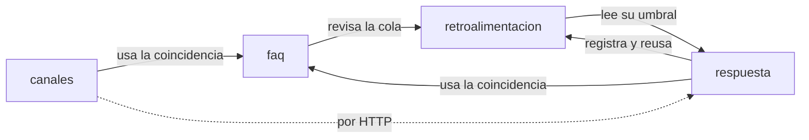

# Dominio

El dominio especificado es el **asistente que responde preguntas de Gestión
Humana**. Los términos que definen reglas (API, conector, cola, texto generado,
superficie de respuesta, condiciones controladas, control de acceso) están en
"Terms" de [`CONSTITUTION.md`](../CONSTITUTION.md) y no se redefinen aquí.

## Lenguaje común

Se usan estos nombres en especificaciones, pruebas y conversaciones.

| Término | Significado | En el código |
|---|---|---|
| Entrada del FAQ | Un tema con sus formas de preguntarlo y una respuesta ya escrita | `faq_rrhh.json` |
| Marcador | Valor entre corchetes dejado sin definir a propósito (R5) | `[X]`, `[sistema]` |
| Coincidencia | Resultado de comparar una pregunta con el FAQ | `RRHHBot.match()` |
| Confianza | Similitud de la coincidencia; no es una probabilidad de acierto | `confianza` |
| Tipo | Qué camino tomó la coincidencia | `tipo` |
| Capa | Qué nivel produjo la respuesta entregada; ver `FLUJOS.md` | `capa` |
| Escalar | Buscar una respuesta en un nivel más costoso | `orquestador.py` |
| Reuso | Entregar una respuesta de la cola sin llamar al conector | `rag_retroalimentacion.py` |
| Canal | Por dónde entra una pregunta y sale la respuesta | portal, puente, n8n |
| Puerta | Entrada de n8n que adapta un canal | flujos 01, 02 y 04 |
| Cerebro | Flujo de n8n que decide la respuesta de sus puertas | flujo 03 |

## Mapa de contextos

La línea punteada es una llamada por red (el portal y el Cerebro llaman a la
API); las continuas son dependencias entre módulos de Python.

| Contexto | Responsabilidad | Tipo |
|---|---|---|
| [respuesta](contextos/respuesta.md) | Decidir qué respuesta se entrega y exponer el contrato | Núcleo |
| [faq](contextos/faq.md) | Mantener el FAQ y comparar preguntas con él | Soporte |
| [retroalimentacion](contextos/retroalimentacion.md) | Guardar lo resuelto por el conector y reusarlo | Soporte |
| [canales](contextos/canales.md) | Llevar preguntas y respuestas por cada canal | Adaptadores |

**Dependencia circular:** `respuesta` usa `retroalimentacion`, y esta importa la
configuración de `respuesta` para leer su umbral. Se declara tal como está;
resolverla es RA-44.

## Fuera de estas especificaciones

El autoservicio del portal (perfil, trámites, vacaciones, certificados y
documentos) es otro dominio y todavía no está especificado (RA-45). Sus pruebas
de extremo a extremo siguen vigentes. Sobre los archivos que el portal no carga, ver
[`FLUJOS.md`](../FLUJOS.md) §4.
