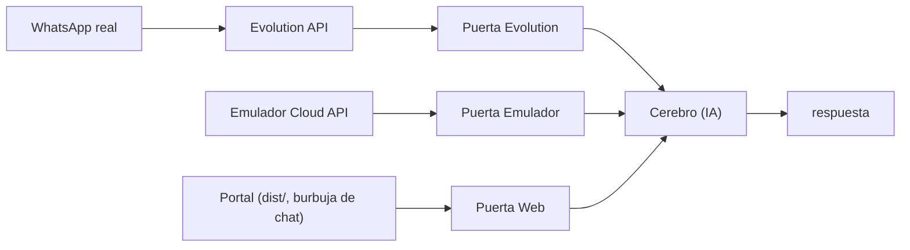

# Canal WhatsApp con n8n (Prebel – Gestión Humana)

Chatbot de Gestión Humana por WhatsApp, hecho en **n8n** con IA local (Ollama).
Responde **solo** con los documentos oficiales de Prebel y dice "no disponible"
cuando la pregunta no está en ellos.

> ⚠️ **Datos reales fuera de git.** Los documentos de Prebel (auxilios, créditos,
> nómina, glosario, tono) tienen nombres, correos, teléfonos y cifras internas.
> No se suben nunca: ni los `.md` originales, ni `data/kb.json` (las fichas que
> salen de ellos), ni `*.real.json` (el cerebro con nombres reales).

## La idea: un cerebro y tres puertas



- **Cerebro** (`03-cerebro-ia.json`): sub-flujo que recibe `pregunta` y devuelve
  la `respuesta` lista para enviar. No sabe de qué canal viene la pregunta,
  así que las tres puertas reciben exactamente las mismas respuestas.
- **Puertas** (`01-puerta-emulador.json`, `02-puerta-evolution.json`,
  `04-puerta-web.json`): adaptadores. Las dos de WhatsApp reciben el mensaje,
  revisan que sea auténtico, marcan "leído", mandan el aviso *"Estoy buscando
  la información… ⏳"* (salvo en los saludos), le preguntan al cerebro y
  devuelven la respuesta. La Puerta Web es más simple -- ver su sección más
  abajo.

### Cómo responde el cerebro: 3 niveles, barato primero

Mismo principio que el resto del repositorio (ver CONSTITUTION.md): capas
baratas/rápidas primero, solo se escala a la siguiente si la anterior no
tiene una respuesta segura.

> **Nota (reducción primaria del modelo):** lo de abajo describe la cadena
> **propia de n8n**, que sus tres puertas siguen usando tal cual, sin
> cambios. Por separado, `model/orquestador.py` orquesta otra cadena
> equivalente del lado de Python, para el portal y cualquier otro llamador
> directo de `/reply` -- con sus propios umbrales (`model/arquitectura.json`)
> y su propio conector LLM intercambiable (`model/conectores.py`). Este
> mismo Cerebro puede servir como el backend de ese conector (vía MCP)
> cuando el equipo lo configure así -- ver CONSTITUTION.md R9 -- pero eso es
> opcional y no cambia nada de lo que sigue en esta sección.

1. **Nivel 0, Predictivo -- saludo o menú** ("hola", "menú", "ayuda"…) →
   responde el menú al instante, sin IA. La lista de saludos vive **solo** en
   el nodo *Detectar saludo (lista única)*. Las puertas la consultan llamando
   al cerebro con `modo = clasificar`.
2. **Nivel 1, ML -- `model/rrhh_api.py`:** se le pregunta primero a ese modelo
   (contenerizado en este mismo servidor, ver "Desplegar `model/rrhh_api.py`"
   más abajo). Si responde con `confianza ≥ 0,65`, se usa esa respuesta
   directamente (< 1 s) y se salta todo lo de abajo. Si no responde, tarda
   demasiado, o su confianza es baja, se sigue al nivel 2 sin bloquear nada
   (`onError: continueErrorOutput`, ver R8 en CONSTITUTION.md).
3. **Nivel 2, Agentic -- RAG con los documentos reales:**
   1. **Embedding** de la pregunta con `embeddinggemma` (Ollama).
   2. Compara con las fichas de la Data Table `prebel_kb` (similitud coseno,
      umbral 0,30, máximo 3 fichas).
   3. Si ninguna ficha se parece → mensaje oficial de "no disponible", sin IA.
   4. Si hay fichas → la IA (Ollama) redacta la respuesta solo con esas fichas.
   5. Agrega la línea *Fuente: documento › sección* y el aviso de que es una
      IA. (La respuesta del Nivel 1 **no** lleva esta línea ni el aviso: no
      es texto redactado por una IA, es una respuesta fija ya elegida.)

Diferencia de fondo entre el Nivel 1 y el Nivel 2: el Nivel 1 **elige** una
respuesta ya escrita del FAQ ficticio (`model/faq_rrhh.json`). El Nivel 2
**redacta** la respuesta a partir de los documentos completos y reales de
Prebel. Antes corrían por separado y se comparaban; ahora están
**encadenados** -- el Nivel 2 solo se usa cuando el Nivel 1 no pudo
responder con seguridad.

## Archivos

| Archivo | Qué es |
|---|---|
| `workflows/01-puerta-emulador.json` | Puerta para el emulador de WhatsApp Cloud API (firma HMAC y token) |
| `workflows/02-puerta-evolution.json` | Puerta para Evolution API (WhatsApp real, cabecera secreta en el webhook) |
| `workflows/03-cerebro-ia.json` | Cerebro con los contactos cambiados por marcadores `[Nombre]` y `[teléfono de Gestión Humana]`. Incluye el Nivel 1 (ML, pregunta primero a `model/rrhh_api.py`) antes del RAG (Nivel 2) |
| `workflows/04-puerta-web.json` | Puerta para el portal (`dist/`): Chat Trigger de n8n + el mismo cerebro. Ver "Puerta Web" más abajo |
| `scripts/ingesta.py` | Parte los documentos de Prebel en fichas → `data/kb.json` |
| `scripts/cargar_kb.py` | Calcula los embeddings y carga las fichas en la Data Table de n8n |
| `scripts/exportar_flujos.py` | Exporta los flujos desde n8n y genera la versión sin datos personales (solo para el servidor CORE-LAB). **Hoy solo conoce los 3 flujos originales** (su `FLUJOS` tiene sus IDs reales fijos en el código) -- `04-puerta-web.json` todavía no existe en el servidor real del equipo, así que no se puede agregar su ID verdadero hasta crearla allá; mientras tanto, esta puerta se edita a mano en el repositorio |

## Cómo montarlo en otro n8n

Requisitos: n8n 2.x, Ollama con los modelos `embeddinggemma` y el modelo de
redacción (hoy `gemma4:e2b`), y el nodo comunitario `n8n-nodes-evolution-api`
(solo para la puerta de Evolution).

Los comandos se corren desde la carpeta `n8n/`.

1. **Fichas:** con los documentos reales en una carpeta que no esté en git
   (en este repo, `.specs/`, ignorada por `.gitignore`):
   ```bash
   PREBEL_DOCS_DIR=../.specs python3 -I scripts/ingesta.py
   ```
2. **Data Table:** crea en n8n una tabla `prebel_kb` con las columnas
   `ficha_id`, `documento`, `seccion`, `texto` y `embedding` (todas texto), y cárgala:
   ```bash
   N8N_API_URL=https://tu-n8n N8N_API_KEY=... OLLAMA_URL=http://localhost:11434 \
     python3 -I scripts/cargar_kb.py <ID_DE_LA_TABLA>
   ```
3. **Desplegar `model/rrhh_api.py` (Nivel 1, ML):** construye la imagen del
   `Dockerfile` en la raíz del repositorio y despliégala **en la misma red
   privada de Docker que n8n y Ollama** (p. ej. otro servicio de Coolify) --
   nunca con el puerto mapeado a una IP pública: solo el Cerebro debe poder
   alcanzarla.
   ```bash
   docker build -t prebel-rrhh-api .
   docker run -d --name prebel-rrhh-api --network <red-de-coolify-con-n8n-y-ollama> prebel-rrhh-api
   ```
4. **Importa los flujos** (menú *Import from File*): primero el cerebro, luego las puertas.
5. **Ajusta después de importar:**
   - En el cerebro: el nodo *Leer fichas* (elige tu tabla), la URL de Ollama en
     *Embedding de la pregunta*, la URL de *Preguntar al modelo FAQ* (el nombre
     de contenedor/red que le diste a `prebel-rrhh-api` en el paso 3), la
     credencial de *Modelo Ollama* y los marcadores `[Nombre]` /
     `[teléfono de Gestión Humana]` en los avisos.
   - En cada puerta de WhatsApp: los dos nodos *¿Es saludo?* y *Preguntar al
     cerebro* (elige el cerebro importado) y las credenciales.
   - En la Puerta Web: *Allowed Origins* del *Chat Trigger* (el origen real
     del portal, no `*`) y el nodo *Preguntar al cerebro* (elige el cerebro
     importado).
6. **Credenciales** (se crean a mano; sus valores nunca van al repo):
   - Emulador: `Crypto` (secreto HMAC del emulador) y `Bearer Auth` (token).
   - Evolution: `Evolution API` (instancia) y `Header Auth` (cabecera secreta del webhook).
   - Ollama: credencial de Ollama apuntando a tu servidor.

## Dónde corre y por qué este modelo

Los dos canales (WhatsApp real por Evolution y el emulador) usan **el mismo
cerebro y la misma IA local**. Nada se manda a servicios de IA externos: los
documentos de Prebel y las preguntas de los empleados no salen del servidor.

**Servidor (entorno de pruebas del equipo):**

| Recurso | Valor | Qué implica |
|---|---|---|
| Máquina | Nube, procesador ARM64 de 4 núcleos | Sin tarjeta gráfica (GPU): la IA corre en el procesador, despacio |
| Memoria RAM | 23 GB, compartida con n8n, bases de datos y otros servicios | Cabe un modelo pequeño o mediano a la vez, no uno grande |
| Disco | 96 GB, ~80 % usado | Cada modelo nuevo ocupa de 3 a 10 GB; hay que elegir pocos |
| Orquestación | Coolify (Docker) + n8n 2.x + Ollama | Todo se despliega como contenedores |

**Modelos en uso:**

- `embeddinggemma` (0,6 GB): convierte textos en "coordenadas" para buscar
  las fichas parecidas. Tarda ~0,4 s.
- `gemma4:e2b` (4,6 GB): redacta la respuesta.

**Por qué `gemma4:e2b`:** comparamos tres modelos con las mismas 5 preguntas,
las mismas fichas y el mismo prompt (2026-11-23):

| Modelo | Tamaño | Tiempo por respuesta | Resultado |
|---|---|---|---|
| `gemma4:e4b` (el anterior) | 9,6 GB | 48–69 s | Muy bueno, pero el doble de lento; a veces se cortaba por largo |
| **`gemma4:e2b` (elegido)** | 4,6 GB | **20–26 s** | Mismas cifras y requisitos; buen español; respeta el formato de WhatsApp |
| `gemma3:4b` | 3,4 GB | 39–62 s | Más lento y usa negritas dobles que WhatsApp no muestra |

Modelos más grandes (26B o 31B) no caben en la RAM disponible. Usar una IA
en la nube sería mucho más rápido, pero los documentos y las preguntas
saldrían del servidor; para el MVP se decidió mantenerlo local.

**Tiempos que ve el usuario:**

- Saludo o "no disponible": 1–3 s.
- Respuesta con IA: ~16–26 s. La primera después de un rato sin uso puede
  tardar 1–2 min más mientras el modelo se carga en memoria. Por eso el bot
  manda primero el aviso "buscando".
- El servidor procesa **una pregunta con IA a la vez**: si llegan 5 juntas,
  la quinta espera a las otras cuatro. Sirve para una demo, no para muchos
  usuarios simultáneos.

## Cómo se compara con el bot de `model/` (Nivel 1 vs. Nivel 2)

| | `model/rrhh_api.py` (Nivel 1, ML) | RAG del Cerebro (Nivel 2, Agentic) |
|---|---|---|
| Cómo responde | **Elige** la entrada del FAQ más parecida (MiniLM, umbral 0,65) | **Busca** fichas de los documentos reales (embeddinggemma, umbral 0,30) y la IA **redacta** con ellas |
| Fuente | `model/faq_rrhh.json` (contenido ficticio con marcadores) | Documentos oficiales de Prebel (fuera de git) |
| Velocidad | < 1 s | 16–26 s |
| Si no sabe | Texto de respaldo, escribir a RRHH | Mensaje oficial "no disponible" |
| Extra | Sentimiento, área, ruta al trámite | Línea *Fuente: documento › sección* y aviso de IA |
| Dónde corre | Contenerizado (ver Dockerfile): PC del operador para el portal, o junto a n8n/Ollama para que el Cerebro lo alcance | Servidor del equipo |

Ya no son dos sistemas aparte para comparar: están **encadenados** (ver
"Cómo responde el cerebro" más arriba y CONSTITUTION.md). El Nivel 2 solo se
usa cuando el Nivel 1 no tiene una respuesta segura.

### El emulador y `model/whatsapp_service.py`

Los dos hablan el mismo protocolo (WhatsApp Cloud API). Pero un emulador
manda los mensajes a **un solo** webhook: o a `whatsapp_service.py` o a la
Puerta Emulador de n8n, no a los dos a la vez. El emulador del servidor está
conectado a n8n; para probar `whatsapp_service.py` se usa un emulador local.

### Puerta Web: el botón de chat en el portal

**No** se abre el emulador desde el portal -- es una herramienta de pruebas
(todos los visitantes verían la misma conversación, y su pestaña *Config*
deja cambiar la conexión) y además el portal está en HTTPS (GitHub Pages)
mientras el emulador está en HTTP, así que el navegador lo bloquearía.

En su lugar, `workflows/04-puerta-web.json` es una tercera puerta: el nodo
*Chat Trigger* de n8n publica un chat por HTTPS que el portal incrusta como
una burbuja con el paquete `@n8n/chat`. Cada visitante tiene su propia
conversación y usa el mismo cerebro -- a diferencia de las puertas de
WhatsApp (asíncronas, con avisos de "leído" y "buscando"), el Chat Trigger
es una llamada síncrona normal: el propio widget muestra su indicador de
carga mientras espera, sin pasos adicionales en el flujo.

**Lado del portal** (`dist/app.js`, al final del archivo): la burbuja
**nunca** se carga para un visitante cualquiera -- dos candados, no uno:

- Solo se intenta si la URL trae `?chat=demo`.
- Y solo si `CHAT_WEBHOOK_URL` ya no tiene su placeholder entre corchetes
  (`[URL del Chat Trigger de n8n, p. ej. ...]`, mismo marcador intencional
  que R5 en CONSTITUTION.md) -- hasta que el equipo no reemplace ese valor
  con la URL real del Chat Trigger importado, la burbuja no hace nada, ni
  siquiera con el parámetro en la URL.

Cómo cumple `CONSTITUTION.md`:

- **R2 (static-first):** la burbuja se carga aparte (import dinámico, al
  final de `app.js`) y nunca bloquea nada; si n8n no responde o el script
  falla, el portal sigue funcionando igual.
- **R3 (sin secretos en el cliente):** la URL del chat es pública por
  diseño -- se limita a los orígenes permitidos (opción *Allowed Origins*
  del Chat Trigger, ajústala tras importar) y no lleva claves.
- **Capacidad:** el servidor responde una pregunta con IA a la vez -- por
  eso el candado del parámetro `?chat=demo`, para no exponerla a todo
  visitante de GitHub Pages.

**Para activarla de verdad:** importa `04-puerta-web.json`, configura
*Allowed Origins*, copia la URL pública del *Chat Trigger* y reemplaza el
placeholder de `CHAT_WEBHOOK_URL` en `dist/app.js` con esa URL real. El
nombre exacto del paquete `@n8n/chat` (CDN, versión del bundle) no se pudo
verificar contra un Chat Trigger real desde este repositorio -- revísalo
contra la documentación de `@n8n/chat` al activarla.

## Probar los flujos en un n8n local (sin el servidor del equipo)

Para probar cambios al cerebro o a una puerta antes de importarlos en el
servidor real, un n8n local con Docker alcanza para validar la lógica (no
el RAG completo, que necesita el Ollama y la Data Table reales):

```powershell
docker network create prebel-test-net
docker run -d --name n8n-test --network prebel-test-net -p 5678:5678 `
  -v n8n_test_data:/home/node/.n8n n8nio/n8n
docker run -d --name prebel-rrhh-api --network prebel-test-net prebel-rrhh-api
```

1. **Importa el cerebro:** `docker cp workflows/03-cerebro-ia.json n8n-test:/tmp/`
   y `docker exec n8n-test n8n import:workflow --input=/tmp/03-cerebro-ia.json`.
   Anota el ID que imprime (es nuevo en cada instancia -- no es
   `FMh0nT4mwTi0x72z`, el del servidor real).
2. **Credencial de Ollama (placeholder, no necesita funcionar de verdad si
   solo pruebas el Nivel 0/1):** `n8n import:credentials` con un JSON
   mínimo `[{"id": "lavzpuOvyjnfq4Gy", "name": "Ollama local (red Coolify)",
   "type": "ollamaApi", "data": {"baseUrl": "http://localhost:11434"}}]`
   (mismo `id` que usa el nodo *Modelo Ollama (gemma4)*) -- sin esto, n8n no
   deja activar el cerebro.
3. **Importa una puerta** (p. ej. `04-puerta-web.json`, la más simple):
   antes de importarla, reemplaza el `workflowId.value` de su nodo
   *Preguntar al cerebro* por el ID nuevo del paso 1.
4. **Activa ambos** (el cerebro primero, es un sub-flujo):
   `docker exec n8n-test n8n update:workflow --id=<id> --active=true`.
5. **Prueba contra el webhook del Chat Trigger:**
   ```bash
   curl -X POST http://localhost:5678/webhook/<webhookId>/chat \
     -H "Content-Type: application/json" \
     -d '{"chatInput":"cuantas licencias medicas he tomado","sessionId":"x"}'
   ```
   Así se confirmó (2026-11-24) que el Nivel 1 responde al instante y sin
   tocar el Nivel 2 cuando hay confianza, que cae con gracia al Nivel 2 (y
   de ahí a "Responder con disculpa") si `prebel-rrhh-api` está caído
   (`docker stop prebel-rrhh-api`), y que se recupera sin reimportar nada
   al volver a levantarlo.

Limpieza: `docker rm -f n8n-test prebel-rrhh-api && docker network rm prebel-test-net && docker volume rm n8n_test_data`.
